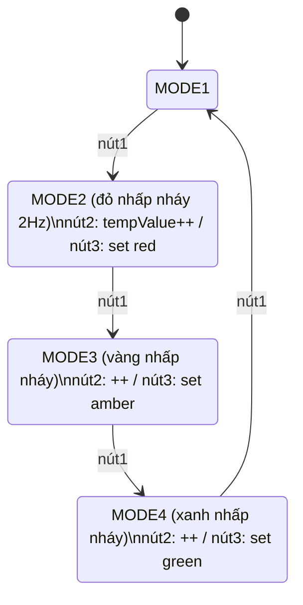
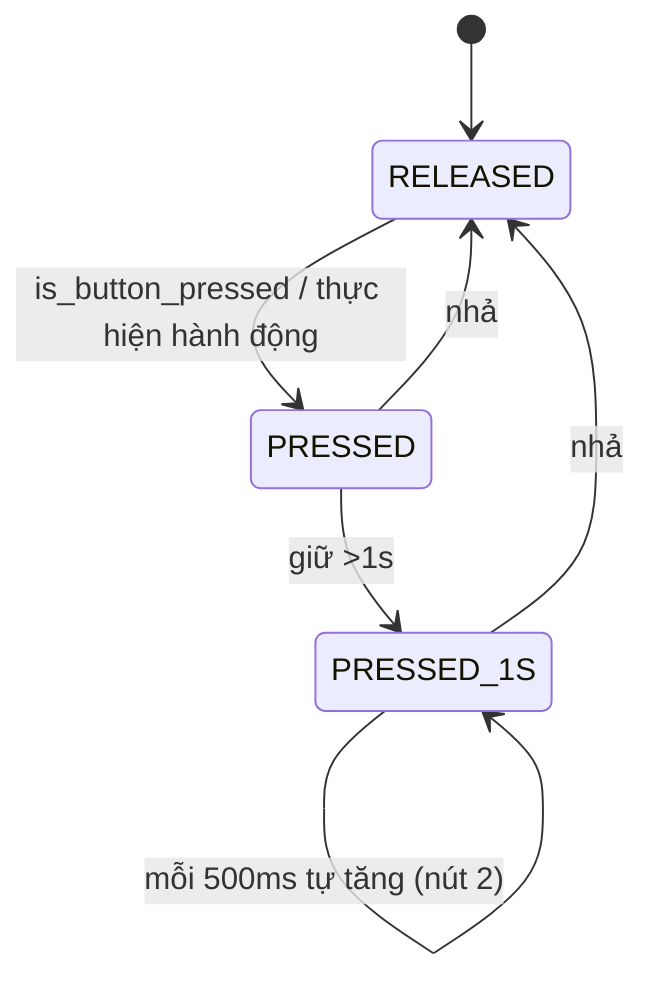

# Lab 3 – Buttons/Switches: hướng dẫn từng Exercise

## Ghi chú về bài mẫu GitHub
Repo `BKIT_ARM4/Lab3_LCD_Button` dành cho **kit BKIT (STM32F407)**: quét ma trận nút 4x4 qua SPI mỗi 50 ms (`button_count[]`), LED 7 đoạn quét bằng TIM4 1 ms, LCD test. **Không có bài đèn giao thông**, nên không dùng làm đáp án trực tiếp.
Ý tưởng dùng lại được: debounce bằng cách đọc theo chu kỳ cố định; "nhấn" = `button_count == 1`; "giữ >1 s, lặp mỗi 100 ms" = `count > 20 && count % 2 == 0`; software timer qua cờ `timerX_flag`.
Code trong `Lab3_code/` viết theo đề (STM32F103 + Proteus).

## Pin mapping (dùng cho Exercise 2 và 3)
| Chức năng | Chân |
|---|---|
| Đèn đường 1: Đỏ/Vàng/Xanh | PA0 / PA1 / PA2 |
| Đèn đường 2: Đỏ/Vàng/Xanh | PA3 / PA4 / PA5 |
| Enable 4 LED 7 đoạn (active LOW) | PA6, PA7, PA8, PA9 |
| Đoạn a–g (active LOW) | PB0–PB6 |
| Nút 1 (mode), 2 (tăng), 3 (set) – input pull-up | PB10, PB11, PB12 |

12 đèn = 4 đỏ + 4 vàng + 4 xanh: hai đèn đối diện cùng đường nối chung 1 chân (mỗi chân ra 2 LED).

## Exercise 1 – FSM
Hai FSM:
1. **Nút** (mỗi nút): `RELEASED → PRESSED` khi nhấn (thực hiện hành động 1 lần); `PRESSED → PRESSED_1S` khi giữ >1 s; về `RELEASED` khi nhả. Ở `PRESSED_1S` nút 2 tự tăng mỗi 500 ms.
2. **Ứng dụng** (mode): `MODE1 → MODE2 → MODE3 → MODE4 → MODE1` mỗi lần nhấn nút 1.
   - MODE1: mỗi đường có FSM `RED → GREEN → AMBER → RED` (đường 1 bắt đầu RED, đường 2 bắt đầu GREEN).
   - MODE2/3/4: nút 2 `tempValue++` (1..99), nút 3 lưu `duration[màu] = tempValue`.

Dán vào draw.io/mermaid.live để xuất ảnh cho báo cáo.

## Exercise 2 – Proteus
STM32F103C6, 6 LED (+ điện trở ~330 Ω xuống GND), 4 × `7SEG-COM-ANODE` nối chung a–g vào PB0–PB6, chân chung của từng LED qua PNP (base ← ENx qua điện trở 1k, emitter → VCC), 3 nút nối chân PBx–GND. Chụp ảnh schematic cho báo cáo.

## Exercise 3 – Project STM32
CubeMX: PA0–PA9 và PB0–PB6 = GPIO_Output; PB10–PB12 = GPIO_Input + **Pull-up**; TIM2: Clock Source Internal, Prescaler 7999, Counter Period 9 (8 MHz → 10 ms), bật NVIC TIM2 global interrupt. Chạy `HAL_TIM_Base_Start_IT(&htim2)` trong `main`.

## Exercise 4 – Đổi chu kỳ timer
Chỉ sửa **một** nơi: `TICK_MS` trong `global.h` (và Prescaler/Period trong CubeMX cho khớp). Mọi hàm `setTimer(i, ms)` quy đổi `ms / TICK_MS`, nên LED vẫn nhấp nháy 2 Hz (toggle mỗi 250 ms) dù tick là 1 ms hay 10 ms. Lưu ý thời gian nên là bội số của `TICK_MS` (250 ms với tick 100 ms sẽ bị làm tròn xuống 200 ms).

## Exercise 5 – Debounce + tăng mode
Files: `input_reading.c/h` (debounce 2 buffer như Program 1.2), `input_processing.c/h` (`btn1_press`), `led_display.c/h`. Hai lỗi trong code mẫu của đề cần sửa:
- Mảng `static` mặc định bằng 0 = "đang nhấn" → phải khởi tạo `BUTTON_IS_RELEASED` (`button_init()`).
- Vòng `for` luôn đọc `BUTTON_1` cho mọi `i` → đọc đúng chân `buttonPin[i]`.

## Exercise 6 – Hiển thị mode + nhấp nháy
`update_led_buffer()`: MODE1 hiện 2 số đếm ngược mỗi đường; MODE2–4 hiện 2 số mode (02/03/04) và 2 số `tempValue`. `update_traffic_leds()`: ở MODE2/3/4 chỉ đèn màu tương ứng nhấp nháy 2 Hz, các đèn khác tắt.

## Exercise 7, 8, 9 – Chỉnh đỏ / vàng / xanh
Cùng một đoạn code cho cả ba mode: vào mode thì `tempValue = duration[màu]`; nút 2 tăng (1..99, giữ >1 s tự tăng mỗi 500 ms); nút 3 lưu vào `duration[mode-2]`. Báo cáo: mô tả 3 mode, đưa ảnh Proteus từng mode và đoạn code `btn2_press`, `btn3_press`.
Nên đặt **đỏ = vàng + xanh** nếu không hai đường sẽ lệch pha (code không tự ép ràng buộc này).

## Exercise 10 – Tích hợp
Ghép toàn bộ, quay video: chạy mode 1 → nhấn nút 1 qua mode 2/3/4 (đèn nhấp nháy, 7 đoạn hiện mode + giá trị) → tăng bằng nút 2 (nhấn và giữ) → set bằng nút 3 → về mode 1 và thấy thời gian mới. Nộp báo cáo + code lên BKeL.
